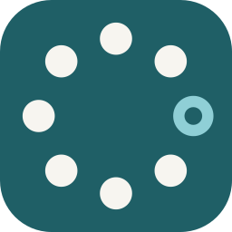
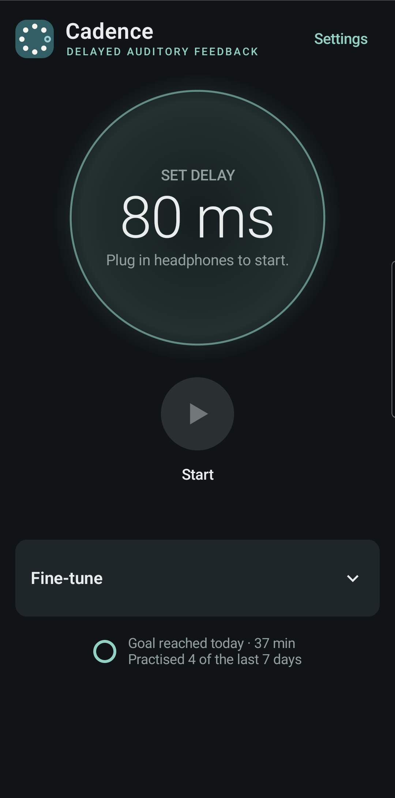
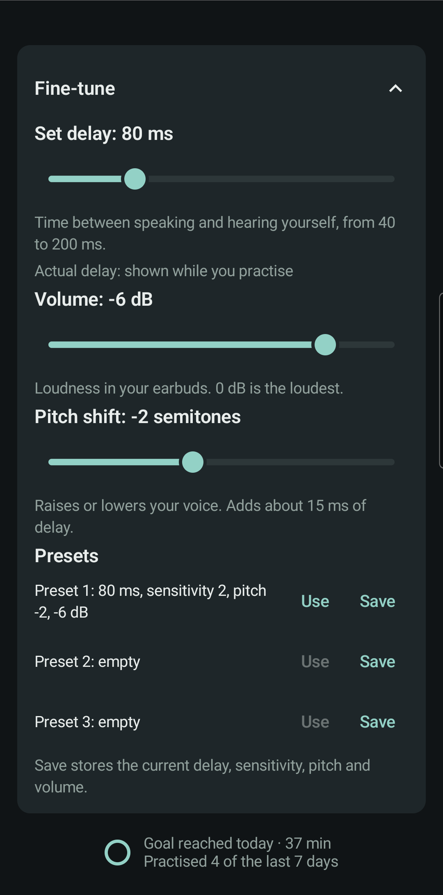
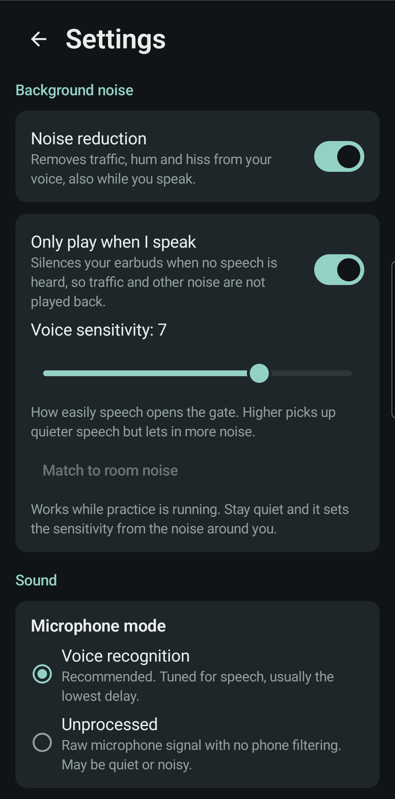
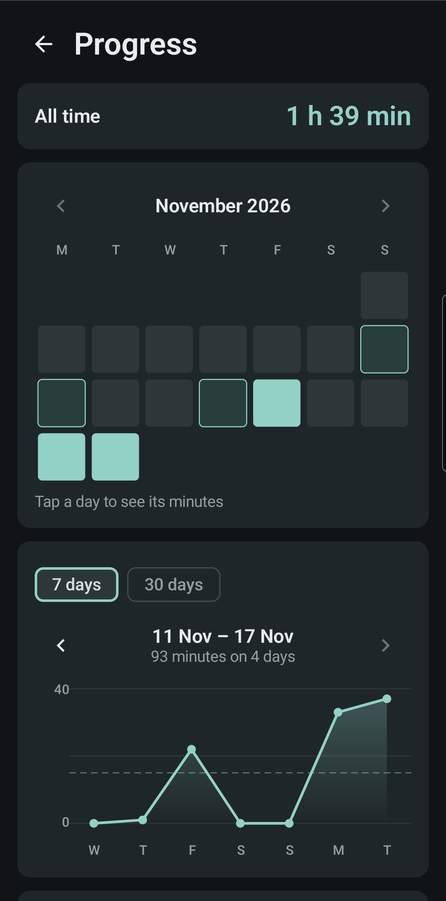

<p align="center"></p>

<h1 align="center">Cadence</h1>

<p align="center"><b>Delayed auditory feedback</b></p>

Cadence is an Android app that plays your own voice back to you with a short delay.

<p align="center">
  
  
  
  
</p>

## What it does

Cadence plays your own voice back to you through wired earbuds, delayed by 40 to 200 milliseconds. A gate mutes the playback when you are not speaking, so traffic and construction noise are not played back. Everything runs on the phone, and you need wired earbuds with a microphone.

## Features

- **Delay:** 40 to 200 ms in 10 ms steps. While you practise, the screen shows the actual delay: your setting plus the delay your phone and earbuds add.
- **Only your voice:** a gate plays back only when you speak. A sensitivity slider sets how easily it opens.
- **Automatic voice boost:** quiet speech from a weak headset microphone is raised to a clear level. Background noise does not raise the boost.
- **Pitch shift and volume:** shift your voice from -12 to +12 semitones and set the loudness in your earbuds.
- **Microphone mode:** Voice recognition (recommended) or Unprocessed.
- **Fading program:** lowers the delay a little every week, down to 40 ms.
- **Runs in the background:** the notification has Stop, Mute and a delay button (60, 100, 150 ms), so it works with the screen off.
- **Stops when it should:** practice stops when you unplug the earbuds, when a call comes in, when another app starts playing, or when you swipe the app away.
- **Helpful hints:** a timer shows how long you have practised, and a hint appears if the microphone is too quiet to hear you.
- **Progress:** a daily goal (off, 5, 10, 15 or 20 minutes), a month calendar you can browse back through, a 7 or 30-day line chart and your all-time total. Only the date and length of each session are saved.
- **Daily reminder (optional):** one notification at a time you choose, skipped when you have already practised that day.

## Why wired earbuds

Wired earbuds add the least extra delay on top of the setting you choose. They also avoid the feedback that open-ear earbuds can cause.

## Requirements

- Android 8.0 or newer
- Wired earbuds with a microphone

## Build

```bash
./gradlew :app:assembleDebug
```

```bash
./gradlew :app:testDebugUnitTest
```

```bash
cmake -S native-tests -B build/native-tests -DCMAKE_BUILD_TYPE=Debug && cmake --build build/native-tests && ctest --test-dir build/native-tests --output-on-failure
```

## Release

- Version name: 0.2.0
- Bundle: app/build/outputs/bundle/release/app-release.aab
- Signing keys are not stored in this repository.

## Privacy

The audio never leaves the phone and is never stored. No account, no ads, no analytics, no internet access.

## License

Cadence is free software under the [GNU General Public License v3.0](LICENSE). libfvad in third_party/libfvad and RNNoise in third_party/rnnoise keep their own BSD licenses.

## Medical disclaimer

Cadence is a practice tool, not a medical device. It does not diagnose or treat any condition.
